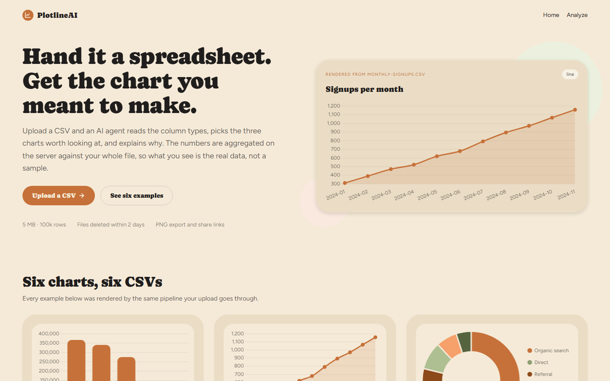
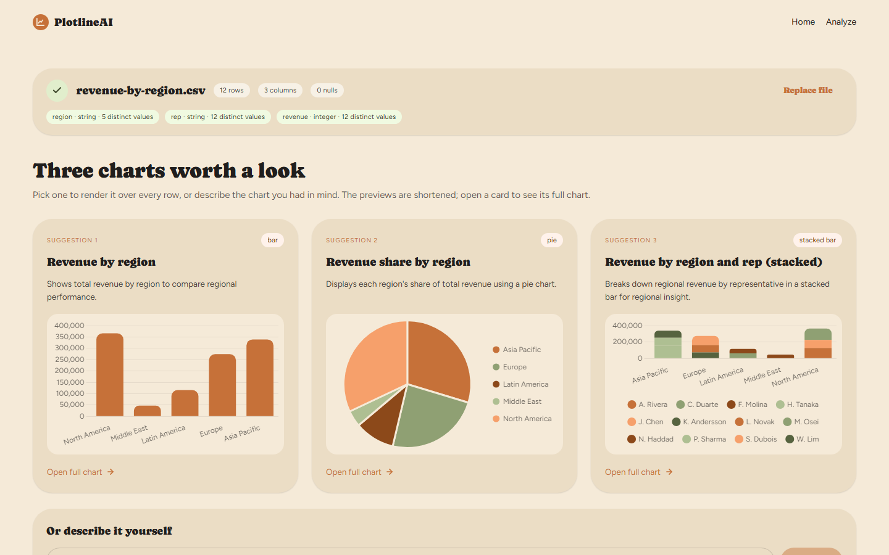
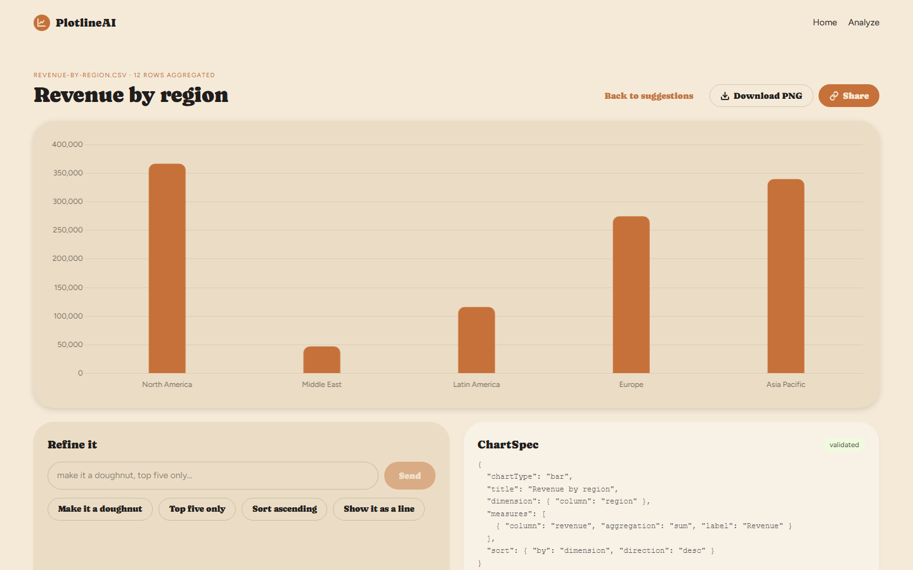
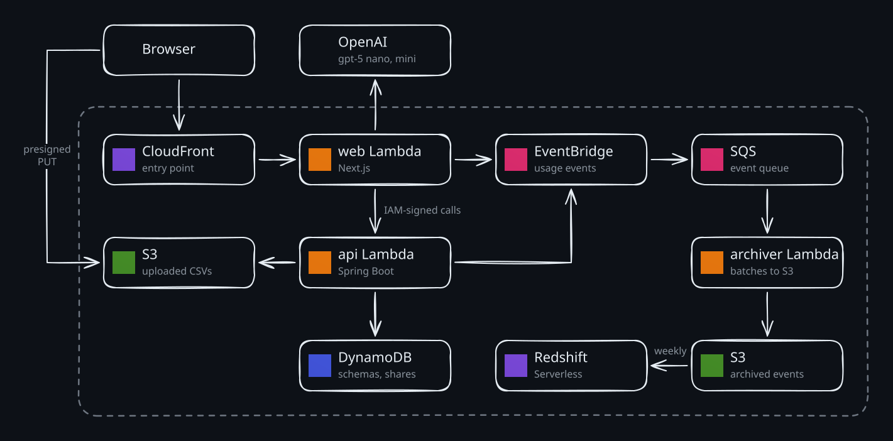

# plotlineai

**Upload a CSV, let an AI agent suggest the charts worth making, and render them from the real data.**

PlotlineAI reads your file's columns, asks a language model for the three charts most worth a look, and then aggregates every row on the server before drawing them - so what you see is the whole dataset, not a sample. Refine a chart in plain words, export it as a PNG, or share a read-only link.

Live at **https://d2c5dopbhn9uhj.cloudfront.net**

---

## Screenshots

<p align="center">

</p>
<p align="center">
  
  &nbsp;&nbsp;
  
</p>

---

## Features

- **Three suggestions per file** - the AI sees the column schema and twenty sample rows, never the whole file, and returns three chart specs with a reason for each
- **Real numbers** - every spec is checked against the stored schema, then aggregated over every row (sum, avg, min, max, count) by the Java service
- **Eight chart types** - bar, horizontal bar, line, area, pie, doughnut, scatter and bubble, with day/week/month/quarter/year time buckets, filters and sorting
- **Describe your own** - type "revenue by region as a doughnut, biggest first" and get that chart
- **Refine in plain words** - "top five only", "show it as a line", or one of the quick chips
- **Messy CSVs welcome** - UTF-8, UTF-16 and Windows-1252; comma, semicolon, tab and pipe delimiters; grouped, European and currency-decorated numbers; 18 date formats; `n/a`-style placeholders counted as missing
- **What stands out** - one to ten insights per file, written by the AI from queries it runs over every row; any number the queries did not produce is dropped before it is shown
- **PNG export and share links** - download the chart, or share a read-only link that carries the insights too
- **Short-lived data** - uploads (up to 5 MB and 100,000 rows) are deleted within 2 days

---

## Installation

Everything runs locally in Docker, with DynamoDB Local and S3Mock standing in for AWS, so no AWS account is needed.

1. Clone this repository
2. Copy the environment file: `cp .env.example .env`
3. Add your `OPENAI_API_KEY` to `.env` (without one, the gallery and manual charts still work)
4. Start the stack: `docker compose up --build`
5. Open http://localhost:3000

---

## Usage

| Action                   | How                                                      |
| ------------------------ | -------------------------------------------------------- |
| Get chart suggestions    | **Upload a CSV** -> drop a file or click to browse       |
| Open a suggestion        | Click its card (or **Open full chart**)                  |
| Ask for a specific chart | Type it under **Or describe it yourself** -> **Draw it** |
| Change a chart           | Type in **Refine it** -> **Send**, or click a chip       |
| Save the chart           | **Download PNG**                                         |
| Share it                 | **Share** -> copy the read-only link                     |
| Try another file         | **Replace file**                                         |

---

## How it works

1. **Parse** - the browser uploads the file straight to S3 through a presigned URL. The Java api then streams it once, detects the encoding and delimiter, infers each column's type and stores the schema.
2. **Suggest** - the Next.js server sends the schema and twenty sample rows to the model and gets back three `ChartSpec`s - a small JSON contract (chart type, dimension, measures, filters, sort). Each is validated with Zod and dry-run against the api; an invalid one is retried once.
3. **Render** - the api checks the spec against the stored schema, aggregates over every row and returns the series. Chart.js draws them in the browser.

The model only ever produces a spec, never data or markup, so a chart can't show a number the file doesn't contain.

---

## Architecture

<!-- The diagram is an Excalidraw file with the scene embedded: open it at excalidraw.com to edit, then export as SVG with "Embed scene" on. -->
<p align="center">

</p>

| Service                 | Role                                                                                                                  |
| ----------------------- | --------------------------------------------------------------------------------------------------------------------- |
| **CloudFront**          | The single public entry point; serves the static build from S3 and forwards everything else to the web function       |
| **Lambda: web**         | Next.js 16 (Node 24) through the Lambda Web Adapter; renders pages and orchestrates the AI calls                       |
| **Lambda: api**         | Spring Boot 4.1 on Java 25 with SnapStart; parsing, schema inference, validation and aggregation                       |
| **S3**                  | Uploaded CSVs (expired by a lifecycle rule), the static Next.js build and the archived usage events                   |
| **DynamoDB**            | Dataset schemas, share links and per-client counters, with TTL cleaning up after them                                 |
| **EventBridge + SQS**   | Usage events (counts and timings, never file contents) fan out to a queue that an archiver function drains into S3    |
| **Redshift Serverless** | A weekly load from S3 feeds SQL views for activity, chart type mix, AI usage and render latency                       |
| **IAM**                 | The web function signs every call to the api; the api is not reachable from the browser except through allowed paths |

Everything is serverless, so nothing runs while no one visits. The infrastructure is defined in AWS CDK as five stacks (data, event pipeline, app, analytics, CI). GitHub Actions runs the test suites on every pull request and, after a merge to `main`, deploys through an OIDC role with no stored AWS keys and smoke-tests the live site.

Locally the same app runs in Docker Compose: Caddy takes the place of CloudFront, and DynamoDB Local and S3Mock replace the AWS storage.

---

## Tech stack

|           |                                                                                    |
| --------- | ---------------------------------------------------------------------------------- |
| Frontend  | Next.js 16, React 19, Tailwind CSS 4, Chart.js 4                                   |
| AI        | Vercel AI SDK 7, OpenAI `gpt-5-nano` (charts) and `gpt-5-mini` (insights), Zod 4   |
| Backend   | Spring Boot 4.1, Java 25                                                           |
| Storage   | DynamoDB, S3                                                                       |
| Analytics | EventBridge, SQS, Redshift Serverless                                              |
| Infra     | AWS CDK, CloudFront, Lambda, Lambda Web Adapter, cdk-nag                           |
| Testing   | JUnit + Testcontainers, Vitest + React Testing Library, Playwright with an AI stub |
| CI/CD     | GitHub Actions with OIDC deploys                                                   |

---

## Project structure

```
plotlineai/
├── frontend/               Next.js app (web)
│   ├── app/                pages: landing, /analyze, /s/[shareId], api routes
│   ├── components/         ChartRenderer, analyze screens
│   ├── lib/ai/             provider, prompt, suggest, spec check
│   ├── lib/security/       CSP, origin check, api path allowlist
│   └── proxy.ts            per-request middleware
├── backend/                Spring Boot service (api)
│   └── src/main/java/com/plotlineai/backend/
│       ├── dataset/        upload, CSV decoding, type inference
│       ├── chart/          spec validation, AggregationEngine
│       ├── share/          read-only share links
│       └── events/         usage events to EventBridge
├── infra/                  AWS CDK
│   ├── lib/                Data, Pipeline, App, Analytics and Ci stacks
│   ├── lambda/             event archiver, Redshift loader
│   └── analytics/          Redshift tables and reporting views
├── e2e/                    Playwright suite + ai-stub (fake OpenAI API)
├── deploy/                 Caddyfile, local AWS init script
├── docs/                   deployment guide, design system, screenshots
└── docker-compose*.yml     local stack, dev and e2e overrides
```

---

## Tests

```bash
cd backend  && ./mvnw verify          # needs Docker (Testcontainers)
cd frontend && npm run lint && npm run typecheck && npm test
cd infra    && npm run typecheck && npm test
```

End to end, against the full stack with the AI stub in place of OpenAI:

```bash
docker compose -f docker-compose.yml -f docker-compose.e2e.yml up -d --build --wait
cd e2e && npm ci && npx playwright install chromium && npx playwright test
```

To deploy your own copy to AWS, see [docs/deploy-aws.md](docs/deploy-aws.md).
